# College parent caller: setup and handover

Release: 8 October 2026. Start with this guide. The ZIP contains source and setup scripts; model weights are downloaded on the receiving PC.

## What is ready, and what still needs a call test

The application supports CSV campaigns, English/Hindi/Kannada language selection, parent affirmation, recorded marks, totals, percentages, missing-data replies, opt-out, local STT/TTS and a local instruction model. Calls are dispatched sequentially, with preparation before dialing. The portable setup adds fresh credentials and independent Docker images.

**The complete system is not yet approved for unattended parent batches.** The last Samsung/Airtel Bluetooth test received parent audio and selected Hindi, but misrecognized a short affirmation and then stalled during playback/hangup before reaching marks. Treat Bluetooth SIM calling as experimental. A normal SIP trunk/college PBX is the recommended deployment path. Verify a full controlled call, normal hangup, denial and opt-out before increasing the batch limit.

GPU support is implemented, with runtime checks for actual CUDA kernels. This development laptop has Intel graphics, so RTX 4080 execution and its latency have not been measured here. A passing synthetic smoke test is not evidence of human phone-speech accuracy or naturalness.

## 1. Receiving PC requirements

| Item | Requirement |
| --- | --- |
| OS | Windows x86-64 with Docker Desktop using WSL 2/Linux containers; or Linux x86-64 with Docker Engine + Compose |
| RAM | 16 GB nominal minimum; 32 GB recommended. Give Docker/WSL at least 8 GB nominal, preferably 10–12 GB on a 16 GB PC. Leave RAM for Windows. |
| GPU | GPU profile requires a CUDA-capable NVIDIA GPU with at least 10 GiB VRAM. The script reads actual capacity with `nvidia-smi`; do not assume a laptop 4080 has desktop capacity. |
| Disk | Allow about 40 GiB free for a fresh GPU installation, or 25–30 GiB for CPU. Model source downloads total **4.92 GB decimal**. Ollama keeps another copy of the 2.62 GB GGUF; derived VITS decoders, Docker images/build cache and recordings also occupy space. |
| Internet during installation | Hugging Face, PyPI, PyTorch wheel index, Docker Hub and Debian/Ubuntu package mirrors. Runtime inference uses local files and containers. |
| Calling | Zoiper for a local controlled test; an existing college PBX/SIP trunk or compatible voice gateway for actual phone numbers. A CSV alone does not provide phone service. |

Install the current NVIDIA Windows driver on a GPU laptop. Docker Desktop GPU access requires the WSL 2 backend. On Linux install the NVIDIA driver and NVIDIA Container Toolkit and configure the Docker runtime. No host Python, CUDA toolkit, Ollama or Python virtual environment is needed for the Windows entry point: Docker supplies them.

Upstream instructions: [Docker Desktop GPU support](https://docs.docker.com/desktop/features/gpu/), [Linux NVIDIA Container Toolkit](https://docs.nvidia.com/datacenter/cloud-native/container-toolkit/latest/install-guide.html).

## 2. Windows: check, then install

Extract the ZIP to a normal local directory, for example `C:\CollegeCaller`, and open PowerShell **inside its `Cursor-MajorProject` folder**. Avoid syncing model downloads through OneDrive if possible.

If Docker Desktop is missing, this optional helper opens its WinGet installer. Finish any UAC prompts, start Docker Desktop, select Linux containers/WSL 2, and complete any requested Windows restart yourself:

```powershell
powershell -NoProfile -ExecutionPolicy Bypass -File .\setup.ps1 -Action Prerequisites
```

On the RTX 4080 laptop:

```powershell
powershell -NoProfile -ExecutionPolicy Bypass -File .\setup.ps1 -Action Check -Profile gpu -Online
powershell -NoProfile -ExecutionPolicy Bypass -File .\setup.ps1 -Action Install -Profile gpu
```

For a machine without NVIDIA GPU support, substitute `-Profile cpu`. Omitting the profile selects GPU when detected VRAM is sufficient, otherwise CPU. CPU inference works but may be too slow for comfortable live calls.

`Check` reads RAM, free disk space, NVIDIA VRAM, Docker daemon/Compose and Docker memory. Its Python bootstrap checks the selected artifact URLs and package registries with `-Online`. It writes `runtime/deployment/preflight.json`. It may pull a small Python bootstrap image. The disk allowance is deliberately conservative and applies to the project drive; check Docker Desktop's separate disk-image drive too.

Windows Install also requires at least 6 GiB currently free host RAM; close other applications if it stops at that check.

`Install` performs these steps:

1. Checks resources and HTTPS access. Stops on failure.
2. Downloads only pinned assets in `deploy/models.lock.json`; checks size and SHA256. Reuses matching files and resumes partial transfers.
3. Generates new ARI, Zoiper and admin passwords locally. Existing credentials and CSV are retained on rerun.
4. Builds standalone CPU/GPU images. No earlier experiment images are required.
5. Exports VITS waveform decoders from the downloaded voices; checks conversion equivalence and a different input length. Reuses verified exports.
6. Imports Gemma into a separate Ollama container, starts the services and runs the three-language verification. **It makes no outbound calls.**

Installation time depends on download speed and image building. There is no promise that a laptop passes until these steps finish. A failed stage exits with an error; inspect its output and rerun after fixing the cause. Model and credential state is retained. Updating the SIP address regenerates the local PJSIP endpoint settings; custom provider configuration belongs in `provider.conf` and is retained.

### HTTPS inspection / antivirus certificate errors

If the report says `CERTIFICATE_VERIFY_FAILED`, obtain the trusted inspection root **from the PC's administrator or antivirus certificate store** as a PEM-encoded `.crt`. Supply it explicitly:

```powershell
powershell -NoProfile -ExecutionPolicy Bypass -File .\setup.ps1 -Action Check -Profile gpu -Online -TrustedCertificate C:\Certificates\trusted-root.crt
powershell -NoProfile -ExecutionPolicy Bypass -File .\setup.ps1 -Action Install -Profile gpu
```

It is copied to `deploy/ca/` and trusted only by the project bootstrap/build environment. It is excluded from source packages. Do not disable TLS checks or use arbitrary internet certificates. Normal networks need no extra certificate. Configure any required proxy in Docker Desktop; Docker image pulls have their own trust/proxy settings.

## 3. Linux

After installing Docker/Compose and, for GPU, the NVIDIA Container Toolkit:

```bash
bash setup.sh check gpu
bash setup.sh install gpu
bash setup.sh verify gpu
bash setup.sh stop gpu
```

Use `cpu` for CPU operation. The Linux wrapper relies on the administrator to provision RAM and NVIDIA drivers; its disk/network preflight and post-start inference checks still run. Put any administrator-approved extra CA as a PEM `.crt` in `deploy/ca/` before building. The deployment currently runs application containers as root; use a dedicated host and restrict access to its data directories.

## 4. Services and model choices

| Layer | Selected implementation | GPU profile |
| --- | --- | --- |
| Parent speech → text | Meta omnilingual CTC 300M v2, pinned FP32 ONNX conversion | ONNX Runtime CUDA; warmup checks real CUDA kernel events |
| Text response | Gemma 4 E2B text QAT, `UD-Q4_K_XL` GGUF, Ollama `gemma4-e2b-college:qat4` | Ollama NVIDIA offload; verification requires nonzero VRAM allocation |
| Text → voice | VoiceAPI VITS `en_female`, `hi_female`, `kn_female` | CPU text encoder/alignment/flow, CUDA ONNX waveform decoder; each voice is tested |
| Dialogue and facts | Python rules, CSV arithmetic, guarded LLM wording | CPU |
| Phone media | Asterisk ARI/PJSIP; G.711 and 8 kHz mono WAV | CPU |

The GPU images pin PyTorch/torchaudio 2.8.0 CUDA 12.8 and ONNX Runtime GPU 1.26.0 (cuDNN 9). ORT 1.27's default GPU wheels use CUDA 13, so the CPU and GPU package versions intentionally differ. See the [official ORT compatibility table](https://onnxruntime.ai/docs/execution-providers/CUDA-ExecutionProvider.html). The CPU image uses ORT 1.27.0. No speculative FP16 conversion or further quantization is enabled.

The configuration starts with one active call, 2,048 LLM context tokens, 96 response tokens, thinking disabled, resident Ollama and one resident VITS voice. CUDA provider selection can leave unsupported individual operations on CPU; the checks require observed CUDA kernels rather than merely an available provider name. Ollama's VRAM check establishes some GPU offload, not that every layer fits. Start with these limits and inspect `nvidia-smi` under load before increasing concurrency.

Published repository licenses: [Meta conversion](https://huggingface.co/EmreAkgul/omniASR-CTC-300M-v2-ONNX) Apache-2.0, [VoiceAPI](https://huggingface.co/Harshil748/VoiceAPI-Models) MIT, [Gemma conversion](https://huggingface.co/unsloth/gemma-4-E2B-it-qat-GGUF) Apache-2.0. The lock pins the tested artifact revisions. Review upstream terms for the college deployment. These selected revisions were publicly downloadable at handover; no cloud AI API key is required. If access later returns 401/403, resolve repository access with its owner; the script does not bypass gates. Downloaded VoiceAPI tokenizer code is pinned and checksummed before execution.

Ports intentionally differ from the older experiment stack:

| Service | Host address |
| --- | --- |
| Caller API/docs | `http://127.0.0.1:8113/docs` |
| STT | `http://127.0.0.1:8110/health` |
| TTS | `http://127.0.0.1:8112/health` |
| Ollama | `http://127.0.0.1:11444` |
| ARI | `http://127.0.0.1:8188/ari` (authenticated API; not a login website) |
| Zoiper SIP | `127.0.0.1:15070`, UDP |
| RTP | UDP 10100–10120 |

API/ARI/model ports are published on loopback. The script does not alter Windows Firewall, restart WSL, change kernels, attach Bluetooth, stop unrelated Docker projects or prune images.

## 5. What verification means

```powershell
powershell -NoProfile -ExecutionPolicy Bypass -File .\setup.ps1 -Action Verify
powershell -NoProfile -ExecutionPolicy Bypass -File .\setup.ps1 -Action Logs
```

Verification checks service readiness, ARI authentication, admin-token enforcement, three synthetic voice generations, nonempty STT transcripts, LLM replies retaining expected scripts/numbers, and the demo caller's language/affirmation/total dialogue. GPU mode additionally checks STT/TTS kernel events and Ollama VRAM. It writes `runtime/deployment/verification.json` and playable `checks/en-smoke.wav`, `hi-smoke.wav`, `kn-smoke.wav`. Listen to those WAVs and inspect the transcripts/replies yourself.

After replacing the demo CSV, verification skips the demo caller dialogue and records that skip, avoiding private records as test inputs. It still runs synthetic speech/model/service checks. This is a smoke test, not WER evaluation, native-speaker semantic review, real phone latency, SIP registration confirmation or production approval. The source ZIP's `HANDOVER_VALIDATION.md` lists which checks were actually performed during packaging.

## 6. Credentials and Zoiper local test

Passwords are created on the receiving PC in **`runtime/deployment/credentials.json`**. They are not in the ZIP and are not credentials to buy from a provider. Keep that file and `compose.json` private. It contains:

- `sip_password`: Zoiper password; username **zoiper1**, domain **127.0.0.1:15070**, transport **UDP**.
- `ari_password`: Asterisk's local REST API password; username **college**.
- `admin_token`: send as `X-Admin-Token` when using the caller API.

Register Zoiper on the same laptop, select its microphone/headphones, then dial **600** for an echo test. Hearing your own voice confirms media to/from Asterisk, not STT.

For another laptop or phone on the same LAN, supply the **server laptop's LAN IPv4** during Install, e.g. `-SipAddress 192.168.1.20`. Zoiper then uses `192.168.1.20:15070`. This publishes SIP/RTP on all host interfaces: the administrator must scope firewall access to the intended LAN. Use the correct LAN interface; a Docker/private WSL IP is not the phone's server address.

To run an intentional local Zoiper audio check after registration, load the token locally and make this API request. **This rings Zoiper.** It does not call the CSV phone over a carrier:

```powershell
$secrets = Get-Content -Raw .\runtime\deployment\credentials.json | ConvertFrom-Json
$headers = @{ 'X-Admin-Token' = $secrets.admin_token }
Invoke-RestMethod -Method Post -Uri http://127.0.0.1:8113/lab/zoiper-audio-check -Headers $headers
```

With the supplied demo CSV, pre-generate the full dialogue and deliberately originate a test call to Zoiper:

```powershell
$body = @{ student_id = 'demo-001' } | ConvertTo-Json
Invoke-RestMethod -Method Post -Uri http://127.0.0.1:8113/calls/prepare -Headers $headers -ContentType application/json -Body $body
Invoke-RestMethod -Method Post -Uri http://127.0.0.1:8113/calls/originate -Headers $headers -ContentType application/json -Body $body
```

Answer, press 1/2/3 for English/Hindi/Kannada, confirm that you are zulkharnain, ask about Mohammed Ayaan's marks, request unavailable attendance, and finish the call. Repeat with the other languages. Check audio both ways, actual reply correctness and clean hangup. The fixed total is **342/400 = 85.5%**. The demo number is an intentionally fictional placeholder. In default `zoiper1` mode calls go to the registered extension regardless of the CSV phone value. For the current MicroSIP demo, use `scripts/Run-LocalSipDemo.ps1` as described in `LOCAL_SIP_DEMO.md`.

## 7. Real parent numbers: college PBX or SIP provider

Get a trunk from the college telephony administrator or a provider offering outbound PSTN/mobile calling. Required values are SIP host/port, username/password or IP authentication, allowed caller ID, registration requirements, codecs and the provider's number format. Zoiper is a SIP client; signing into it does not create a carrier route. Your ordinary mobile number cannot act as a SIP trunk without a compatible SIM voice gateway.

1. Fill `deploy/sip-provider.example.conf` with the provider's values and save it as `runtime/deployment/asterisk/provider.conf`. The example assumes username/password registration; adapt it to the provider's official settings. The file is included in PJSIP and preserved on setup reruns.
2. Save caller changes in `runtime/deployment/caller-overrides.json`, with string values:

```json
{
  "SIP_TRUNK": "provider",
  "SIP_DIAL_FORMAT": "e164_digits",
  "OUTBOUND_CALLER_ID": "\"College\" <YOUR_AUTHORIZED_NUMBER>",
  "COLLEGE_NAME": "Your College"
}
```

3. Regenerate configuration with the bootstrap command below. Use the same profile/SIP address as installation. This does not place calls. Restart only this project's PBX/caller to apply changes:

```powershell
$root = (Get-Location).Path
docker run --rm --mount "type=bind,source=$root,target=/workspace" -w /workspace python:3.11-slim-bookworm python scripts/portable_setup.py configure --profile gpu --host-root "$root" --sip-address 127.0.0.1
docker compose -f runtime/deployment/compose.json up -d --force-recreate pbx caller
docker compose -f runtime/deployment/compose.json exec pbx asterisk -rx 'pjsip show registrations'
docker compose -f runtime/deployment/compose.json exec pbx asterisk -rx 'pjsip show contacts'
```

Correct public/LAN advertised SIP/RTP addresses and firewall/NAT settings must match the provider's topology. Loopback is appropriate only for Zoiper on the server laptop, not remote provider media. A provider trunk may require the server's public address and forwarding. Work with the college network administrator. Do not expose ARI/model/admin ports to the internet.

## 8. CSV and batches

Replace `runtime/deployment/students.csv` with the college CSV, preserving UTF-8 and the example header. Required identity columns: `parent_name,parent_phone,student_id,student_name`; marks columns must contain integer scores within `MAX_MARKS_PER_SUBJECT` (100 default). Optional metadata includes `class,section,language,teacher_name,teacher_phone` and native Hindi/Kannada parent/student names. Supply native spellings for clear TTS pronunciation; unsupported characters fail instead of silently removing facts. Marks/column names can be adapted, but review variable subject pronunciation and replies.

Use `language` values `en`, `hi`, `kn` when supplied. The call still asks the preferred language. Same-parent siblings at one phone are grouped. Conflicting parent identities are rejected. The example data is fictional; protect actual CSVs, campaign databases and recordings. Access at the CSV phone plus verbal affirmation is not strong identity authentication.

Preview and import only (no calls):

```powershell
docker compose -f runtime/deployment/compose.json exec -T caller python -m app.campaign preview /workspace/runtime/deployment/students.csv
docker compose -f runtime/deployment/compose.json exec -T caller python -m app.campaign import /workspace/runtime/deployment/students.csv --name 'Controlled pilot'
```

Copy the returned `campaign_id`. Once the SIP route and one controlled full call pass, this command **places real calls** when `SIP_TRUNK=provider`; begin with a consented test number and limit one:

```powershell
docker compose -f runtime/deployment/compose.json exec -T caller python -m app.campaign run CAMPAIGN_ID --execute --limit 1
docker compose -f runtime/deployment/compose.json exec -T caller python -m app.campaign status CAMPAIGN_ID
```

Increase `--limit` only after reviewing the pilot. Preparation happens before dialing, so first campaign preparation can take time without keeping the parent waiting. The runner snapshots CSV records, tracks outcomes/opt-outs in `runtime/deployment/campaigns.sqlite3`, refuses overlap and pauses when a call does not finish. Do not blindly retry a stalled call; confirm the handset and PBX channels have ended first. Requeueing requires a reviewed call ID and an explicit `--execute`.

## 9. Pipeline and response delay

```mermaid
flowchart LR
  CSV[CSV records] --> Prep[Prepare factual replies and cached speech]
  Prep --> Dial[Asterisk SIP call]
  Dial --> Audio[Parent RTP audio and silence endpoint]
  Audio --> STT[Meta CTC transcript]
  STT --> Facts[Language, identity, intent and CSV facts]
  Facts --> LLM[Guarded local Gemma wording or fixed fallback]
  LLM --> TTS[Cached audio or VITS clause synthesis]
  TTS --> Play[Asterisk RTP playback to parent]
```



Text is interpreted while respecting the call state. The app calculates marks and totals; the LLM produces wording from trusted facts. Missing attendance/behavior/rank data gets a fixed unavailable-data reply plus an invitation for another question. The app checks names, numbers, subject and language script before adopting model wording; those checks do not prove semantic correctness.

Incoming audio is buffered and partial transcription is implemented for sufficiently long utterances. Short answers often finish before a useful partial result exists. No final reply is played until the utterance ends and identity/state checks pass. Long uncached TTS replies are split into clauses, with the next chunk synthesized while the current one plays. This is chunked text/audio production, not a native token-streaming VITS model.

Delay after the parent stops speaking is approximately: silence endpoint (1 s configured) + any remaining ASR + routing/uncached LLM + first uncached audio chunk + resampling/ARI/RTP/handset delay. Cached prepared replies bypass LLM/TTS generation. No RTX 4080 end-to-end number is promised; inspect `[CALL LATENCY]` logs and measure at the receiving handset. ARI playback timestamps exclude carrier and handset buffering.

## 10. Restart, backup and troubleshooting

```powershell
powershell -NoProfile -ExecutionPolicy Bypass -File .\setup.ps1 -Action Start
powershell -NoProfile -ExecutionPolicy Bypass -File .\setup.ps1 -Action Stop
docker compose -f runtime/deployment/compose.json ps
```

`Stop` retains downloaded models, generated credentials and campaign state. Back up private `runtime/deployment/` and the CSV according to college policy; do not put them on public GitHub. Source code can be hosted on GitHub; GPU models and live SIP/media services run on the laptop/server, not on GitHub Pages.

- **No Docker / wrong container mode:** open Docker Desktop, select Linux/WSL 2, then rerun Check.
- **CUDA unavailable or CPU-only execution:** update NVIDIA driver/WSL, check Docker GPU access and Linux Toolkit where applicable. GPU Verify must pass; CPU fallback is not accepted as GPU success.
- **Disk/RAM low:** move the extracted project/Docker disk to an SSD with room; close unrelated apps. Setup does not delete anyone's images/models automatically.
- **TTS unsupported characters:** add correct native parent/student spellings in the CSV; optionally supply `data/vits-pronunciations.json`. Reprepare affected audio.
- **HTTP 401 caller API:** send the newly generated local `X-Admin-Token`; do not copy the old laptop's token.
- **No microphone/one-way audio:** run Zoiper echo and the deliberate audio check, then check its device selection, SIP contact, advertised RTP address and LAN firewall.
- **ARI returns an error page:** it is a REST API with basic auth. Use the generated `college` credentials and `/ari/asterisk/info`; visiting `/ari` alone is not a health check.
- **Call stays active:** manually end the controlled call, inspect `core show channels`, and review logs before further dispatch. The Bluetooth stall remains unresolved; no automatic hardware/kernel activation is included here.
